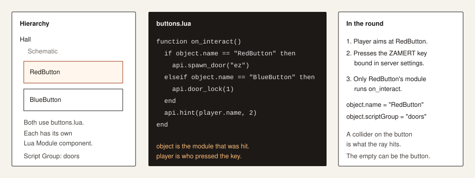

# Lua

[Manual](index.md) · [Install](install.md) · [Unity](unity.md) · [Components](components.md) · [Doors and prefabs](doors.md) · [Server](server.md)

Lua Module is a component. The script runs on the object you put it on. A shared file still means one runtime per object, so `object.name` tells them apart.



## Inspector

| Field | What you set |
|---|---|
| `Inline Script` | The source. Used when it is not empty. |
| `Script Path` | A `.lua` file beside the schematic, used when Inline Script is empty. |
| `Input Key Code` | Unity KeyCode. `0` = no key. `101` = E. |
| `Interaction Max Range` | Metres. `0` is treated as 5. |
| `Listen Enter / Stay / Exit` | Calls `on_enter`, `on_stay`, `on_exit` for a player touching a trigger on this object. |
| `Tick Interval` | Seconds between `on_tick`. Below `0.1` the tick is off. |
| `Script Group` | Your label. Read it as `object.scriptGroup`. |

Compile with `SchematicManager → Compile Lua Modules` or Compile All. The file is `{Name}-LuaModules.json`.

## What runs, and when

The source runs once when the schematic spawns. That run defines your functions and also runs any loose code at the top level.

| Function | When |
|---|---|
| top-level code | schematic spawn |
| `on_interact` | player aims at this module and presses its key |
| `on_enter` | player enters the trigger |
| `on_stay` | player remains, at most every 0.25 s |
| `on_exit` | player leaves the trigger |
| `on_tick` | every Tick Interval, if it is at least 0.1 s |

Functions have to be global. `local function on_interact` is invisible to the event caller.

```lua
function on_interact()
  api.hint(player.name .. " used " .. object.name, 2)
end
```

Put function definitions above a loop that waits. The function does not exist until the interpreter reaches that line. A loop that hits `api.wait` on the first pass never reaches a function written underneath it.

`player` is nil during spawn and during `on_tick` unless you were called from an event that has a player. Read it inside `on_interact`, `on_enter`, `on_stay`, `on_exit`.

## `object` and `player`

`object` (this module):

| Field | |
|---|---|
| `name` | Hierarchy name. |
| `scriptGroup` | Script Group you typed. |
| `code` | Instance id from the compile. Changes if you recompile later. |
| `objectId` | Index path. |
| `type` | `"LuaModule"`. |
| `active` | Active flag. |
| `position` | Position when the table was built. `x`, `y`, `z`. |

`player`:

| Field | |
|---|---|
| `id`, `name`, `userId` | Player id, nickname, user id. |
| `role`, `team` | Role name and team name. Compare with `== "ClassD"`, `== "ChaosInsurgency"`. |
| `isScp`, `isHuman`, `isAlive` | Booleans. |
| `health` | Current health. |
| `position` | `x`, `y`, `z`. |
| `room`, `zone` | Names. |
| `currentItem` | Item type name, or empty. |

`schematic.name` is the MER schematic name. `schematic.directoryPath` is the folder the JSON was loaded from.

Same script, two buttons:

```lua
function on_interact()
  if player.role == "ClassD" then
    api.hint("No.", 2)
    return
  end

  if object.name == "RedButton" then
    api.give_item(player, "KeycardGuard")
    api.spawn_door("ez")
  elseif object.name == "BlueButton" then
    api.door_lock(1)
  end
end
```

## `api.wait`

`api.wait(seconds)` pauses this script. The server keeps running. `api.wait(0)` waits one frame.

```lua
for i = 1, 5 do
  api.broadcast("Count " .. i, 2)
  api.wait(1)
end
```

A `while true` with no `api.wait` is stopped. Defaults: 2500 Lua instructions per slice, 8 slices, then the script is killed and the console says it ran too long. Config keys: `LuaAutoYieldInstructions`, `LuaMaxBusySlices`. One module can have 8 running coroutines. A frame resumes at most `LuaMaxProgramsPerFrame` scripts (default 8). `api.wait` is capped by `MaxFunctionWaitSeconds` (default 600).

`api.wait` works in Lua Module because the source runs as a coroutine. Lua event snippets on other components (`LuaEvents`) are not coroutines. In those, schedule with `api.delay`.

## Players

```lua
api.broadcast("Hello", 5)                 -- text, seconds, everyone
api.hint("Look up", 2)                     -- current player
api.hint_player(player, "Look up", 2)      -- player table, id, or nickname
api.heal_player(player, 25)                -- or api.heal_player(25)
api.damage_player(player, 10, "fence")
api.kill_player(player, "pit")
api.teleport_player(player, 10, 2, 4)      -- or a {x=,y=,z=} table
api.give_item(player, "KeycardGuard")      -- ItemType name
api.set_role(player, "ClassD", 0)          -- third arg 1 also moves them to a spawn
api.players()                              -- array, Lua index 1
api.alive_players()
api.humans()
api.scps()
api.player_count("ClassD")                 -- role or team substring, or empty for all
api.find_player("Nick")                    -- id, nickname, user id, or a player table
api.current_player()
```

`give_item` with one argument gives the item to the current player. `set_role` uses the role enum name (`ClassD`, `Scientist`, `NtfSergeant`, `Scp173`, …). A bad name returns false and does not change the player.

## Doors and prefabs

```lua
api.spawn_door("ez")              -- at this object. also lcz, hcz, bulk, gate
api.spawn_door("gate", 4, 1, 8)   -- world position
api.door_open(1)                  -- nearest door within 6 m. 0 closes
api.door_open(1, 12)              -- same, 12 m
api.door_lock(1)
api.spawn_prefab("Work Station")
api.spawn_prefab("Work Station", 10, 2, 4)
api.spawn_prefab("Work Station", {x = 10, y = 2, z = 4})
api.spawn_prefab("Work Station", 10, 2, 4, {x = 0, y = 90, z = 0}, {x = 1, y = 1, z = 1})
api.list_prefabs("door")          -- up to 40 names
api.prefab_count()
```

`spawn_door` uses the game door prefabs (breakable doors, bulk, gate), parented to the schematic so they die with it. `spawn_prefab` instantiates whatever name is in `NetworkClient.prefabs` on this server. Position is three numbers or one `{x,y,z}` table. Rotation and scale are the fifth and sixth arguments, each a table: name, x, y, z, rotation, scale. Get the spelling from `zamert prefabs`. Doors you want to open and lock later should be `spawn_door`, not a raw prefab.

## Other modules from Lua

Targets are a code, an object name, or omitted for "this object" where the call allows it.

```lua
api.set_active(true)
api.set_active(object.code, false)
api.get_active()
api.set_active_group("doors", false)
api.destroy_self()
api.destroy_by_code(12345)
api.find_by_code(12345)
api.find_group("doors")
api.count_group("doors")
api.call_function("OpenHall")          -- Function Executor on this schematic
api.trigger(object.code, "interacted") -- runs LuaEvents on that object
api.trigger_group("doors", "custom")

api.counter_add("button", 1)           -- Counter by code or name
api.timer_start("clock")
api.timer_stop("clock")
api.light_set("lamp", 2)               -- intensity, 0 turns it off
api.rotator_speed("fan", 0, 90, 0)
api.mover_restart("platform")
api.spawn_schematic("SubRoom")         -- Schematic Anchor by name, or spawn that schematic name here

api.speaker_play("alarm")
api.speaker_stop("alarm")
api.speaker_volume("alarm", 0.4)
api.spawner_spawn("locker")
api.spawner_stop("locker")
api.spawner_reset("locker")
api.damage_trigger_start("pit")
api.damage_trigger_stop("pit")

api.get_current_health("dummy")
api.set_current_health("dummy", 50)
api.damage_healthobject("dummy", 10)
api.heal_healthobject("dummy", 10)
api.nearest_healthobject(8)
api.damage_nearest_healthobject(8, 15)
```

## Variables

Three scopes. Keys are strings. Values are numbers, strings, or booleans.

```lua
api.set_self_var("uses", 0)             -- this object, until it is destroyed
api.inc_self_var("uses", 1)
api.get_self_var("uses")

api.set_schematic_var("power", 1)       -- this schematic instance
api.get_schematic_var("power")
api.inc_schematic_var("power", -1)

api.set_round_var("opened", true)       -- cleared when the next map generates
api.get_round_var("opened")
```

## Time, chance, files, commands

```lua
api.log("opened")
api.warn("missing clip")
api.error("bad state")
api.time()
api.realtime()
api.chance(0.25)                        -- true 25% of the time
api.random_int(1, 6)
api.random_float(0, 1)
api.vec(1, 2, 3)                        -- {x,y,z}
api.distance(a, b)
api.add_vec(a, b)

api.command("cassie 1 Attention")       -- needs LuaAllowServerCommands
api.include("lib.lua")                  -- runs inside this script
api.run_file("once.lua")                -- separate script, does not share locals

api.delay(2, function()
  api.broadcast("later", 3)
end)
api.repeat_every(1, 5, function(ctx, tick)
  api.broadcast("tick " .. tick, 1)
end)
```

`repeat_every` waits at least 0.05 s. The count is clamped to `LuaMaxRepeatCount` (default 100). Both `delay` and `repeat_every` do nothing when `LuaAllowDelayedCallbacks` is false.

`include` and `run_file` look in the schematic folder, then next to the plugin DLL, unless you pass an absolute path.

## Lua Events on other components

Every ZAMERT component has a `Lua Events` list. That is the older hook: a short script on Interact, Death, Enter, and so on. It is not a Lua Module. `api.wait` there throws; use `api.delay`.

| `Event Type` | Fires |
|---|---|
| `Spawned`, `Destroyed` | object lifetime |
| `Interacted`, `Denied` | key accepted, or keycard refused |
| `Searching`, `Picked` | pickup |
| `Damaged`, `Died` | health object |
| `Entered`, `Stayed`, `Exited` | collider |
| `ThresholdReached`, `ThresholdDropped` | player-count trigger |
| `Tick` | where the component ticks |
| `Custom` | `Custom Event Name`, also `api.trigger` |

Each row has priority, chance (`0`–`1`), cooldown, run once, run when cancelled, stop on success. Inline or a file, same path rules.

Inside an event script the globals are the same (`player`, `object`, `api`). `ctx.cancelled`, `ctx.damage`, `ctx.currentHealth` depend on the event. `api.cancel()` / `api.uncancel()` mark the context. `api.stop()` stops later bindings of this event. Pickup events can `api.remove_pickup()` or `api.keep_pickup()`.

`LuaEnabled` false disables both Lua Module and these bindings.
