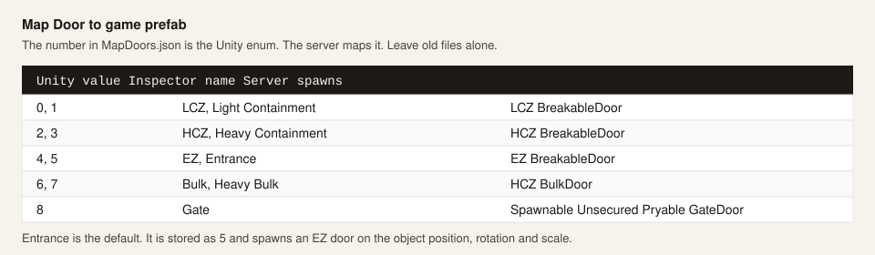

# Kapılar ve prefab

[Kılavuz](index.md) · [Kurulum](install.md) · [Unity](unity.md) · [Lua](lua.md) · [Bileşenler](components.md) · [Sunucu](server.md)

Kapı denen üç ayrı şey var:

| İstediğin | Bileşen |
|---|---|
| Kartlı ve kilitli gerçek LCZ / HCZ / EZ / bulk / gate kapısı | **Map Door** |
| Animator'ın oynattığı kendi mesh'in | **Custom Door** |
| Başka bir network objesi (workstation, dolap, hedef, toy, ham adıyla bir kapı prefabı) | **Prefab Anchor** veya `api.spawn_prefab` |

## Map Door

Kapının duracağı yere, boş objeye Map Door koy. O objenin dönüşü ve ölçeği kapının dönüşü ve ölçeğidir. Derleme `{Ad}-MapDoors.json` yazar.

| Alan | |
|---|---|
| `DoorType` | Aşağıdaki Unity enum. Varsayılan Entrance, 5 olarak durur, EZ kapısı doğurur. |
| `Permissions` | `DoorPermissionFlags`. None kart istemez. |
| `Require All Permissions` | Seçili her bayrak elde olmalı. |
| `Is Open` | Açık doğar. |
| `Is Locked` | Özel kapı kilidiyle kilitli doğar. |



Sunucu schematic doğunca bu tabloyu uygular. ProjectMER'in kendi enum'u daha kısadır (0–4) ve bu sayılarla uyuşmaz. ZAMERT çevirir. Eski `MapDoors.json` dosyalarının numaralarını "düzeltmek" için değiştirme.

Lua'da, çalışma anında bu enum'dan geçmezsin:

```lua
api.spawn_door("lcz")
api.spawn_door("hcz")
api.spawn_door("ez")       -- entrance
api.spawn_door("bulk")
api.spawn_door("gate")
api.spawn_door("ez", x, y, z)
```

`api.door_open(1)` ve `api.door_lock(1)`, script objesinin 6 metresi içindeki en yakın gerçek kapıya gider. Haritada zaten duran kapılar da dahildir. Menzili değiştirmek için ikinci sayı ver. `0` kapatır veya kilidi açar.

Map Door doğuşu MER'in kapı kurulumunu kullanır: o tipe ait prefab, kilit, izin, sonra objenin pozunda network spawn. Konsol kapı prefabının hazır olmadığını söylüyorsa ProjectMER prefab kaydını bitirmemiştir. ZAMERT en son yüklendiği için bu normalde bitmiştir; alışılmış sebep MER eklentisinin eksik olmasıdır.

## SCP-079 kamerası

`Scp079Cameras.json`. `CameraType`: `Lcz` 0, `Hcz` 1, `Ez` 2, `EzArm` 3, `Sz` 4. `Label`, 079 ekranındaki addır, varsayılan `Custom Camera`. Bu sayılar MER ile zaten uyumludur. Kamera objenin transformuna konur.

## Clutter

`Clutter.json`. Tesis clutter parçalarından biri:

| Değer | Parça |
|---|---|
| 0 | Simple Boxes |
| 1 | Pipes Short |
| 2 | Boxes Ladder |
| 3 | Tank Supported Shelf |
| 4 | Angled Fences |
| 5 | Huge Orange Pipes |
| 6 | Pipes Long Open |

## Prefab Anchor

Sunucunun kullandığı adla, herhangi bir network prefab.

| Alan | |
|---|---|
| `Prefab Name` | Birebir string. `workstation` değil, `Work Station`. |
| `Spawn On Start` | Schematic ile doğar. |
| `Spawn As Child` | Anchor'ın çocuğu olur. |
| `Match Scale` | Anchor ölçeğini kopyalar. |
| `Disable Anchor Renderers` | Kılavuz diye koyduğun editör mesh'ini gizler. |
| `Destroy Anchor After Spawn` | Prefab durunca anchor objesini siler. |

Çalıştırdığın sürümün adları:

```text
zamert prefabs
zamert prefabs door
```

Tam liste, eklenti DLL'inin yanındaki `ZAMERT-prefabs.txt` dosyasına yazılır. `api.list_prefabs("work")` scripte en fazla 40 eşleşme döner.

```lua
api.spawn_prefab("Work Station")
api.spawn_prefab("Work Station", 12, 1.2, 8)
```

`api.spawn_prefab`, net id hâlâ 0 ise network spawn eder. Örneği schematic'e bağlama yapmaz, schematic silinince obje durur. Prefab Anchor'da Spawn As Child açıksa bağlanır ve schematic ile gider. Map Door ve `api.spawn_door` schematic'e kayıtlıdır, schematic ile silinir. Oda, dolap düzeni veya kapı izni bekleyen bir prefab eksik kalkabilir. Tesis kapıları Map Door veya `api.spawn_door` üzerinden gitsin. Workstation, hedef, toy ve clutter parçaları Prefab Anchor içindir.

Oyun güncellemeleri prefab adını değiştirir. Bir ad çalışmayı bırakınca o sunucuda `zamert prefabs` çalıştır ve yeni yazımı `PrefabName` alanına yapıştır.
